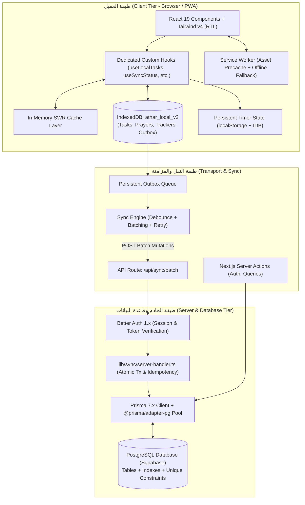

# البنية الهندسية والمعمارية لمشروع «أثـر» (Athar Architecture)

**الإصدار:** 1.0.0-PROD  
**تاريخ التحديث:** 9 نوفمبر 2026  

---

## 1. المخطط المعماري العام (System Architecture Overview)



---

## 2. طبقة التخزين المحلي أولاً (Local-First Persistence Tier)

### 2.1 قاعدة بيانات IndexedDB (`athar_local_v2`)
تتولى إدارة الحالة المحلية المستمرة للمستخدم الضيف والمسجل، وتتضمن المخازن (Object Stores) التالية:

| اسم المخزن (Store) | المفتاح الأساسي (KeyPath) | الفهارس (Indexes) | الغرض |
| :--- | :--- | :--- | :--- |
| `tasks` | `id` (UUID) | `by-user`, `by-user-date`, `by-user-status` | تخزين المهام المحلية وجدولتها وترتيبها |
| `prayer_records` | `id` (UUID) | `by-user-date`, `by-user-prayer-date` | سجل أداء الصلوات الخمس اليومي |
| `trackers` | `id` (UUID) | `by-user` | تعريفات العادات والمتتبعات |
| `tracker_entries` | `id` (UUID) | `by-user-date`, `by-tracker-date` | التدوينات اليومية للعادات |
| `daily_notes` | `id` (UUID) | `by-user-date` | مذكرات اليوميات والمشاعر |
| `abstinence_trackers`| `id` (UUID) | `by-user` | متتبعات التعافي والامتناع |
| `abstinence_sessions`| `id` (UUID) | `by-user`, `by-user-tracker` | جلسات الامتناع وسجلات الانتكاس |
| `outbox` | `mutationId` (UUID) | `by-user-status` | طابور التعديلات الصادرة المعلقة للمزامنة |
| `metadata` | `key` | - | تفضيلات التطبيق المحلية وأوقات المزامنة |

### 2.2 نمط القراءة الفورية والتحديث في الخلفية (SWR Navigation)
- عند فتح أي مسار (`/`, `/habits`, `/journal`):
  1. القراءة اللحظية من الذاكرة أو `IndexedDB` وعرض البيانات مباشرة في أقل من 10ms.
  2. منع ظهور أي مؤشر تحميل عشوائي (Skeleton) إذا توفرت بيانات مسبقة.
  3. استدعاء استعلام الخادم في الخلفية (Revalidation) دون التسبب في أي وميض أو قفزة بصرية (Layout Shift).

---

## 3. محرك المزامنة السحابية (Cloud Sync Engine)

### 3.1 معالجة الطفرات وضمان عدم فقدان البيانات (No Data Loss Guarantee)
1. كل عملية تعديل في العميل (Create, Update, Delete) تسجل فوراً في `outbox` محلياً مع توليد معرف `mutationId` فريد.
2. ترسل العمليات في حزم (Batches) إلى المسار `/api/sync/batch`.
3. **قاعدة حتمية:** لا يقوم الخادم أبداً بتسجيل إيصال `MutationReceipt` لكيان لم يتم حفظه بنجاح داخل قاعدة البيانات عبر معاملة موحدة (`prisma.$transaction`).
4. **تغطية شاملة لكافة الكيانات:** يدعم معالج الخادم كافة الكيانات:
   - `task`
   - `prayer_record`
   - `tracker`
   - `tracker_entry`
   - `daily_note`
   - `abstinence`
   - `life_area`
   - `gym_workout`
   - `meal_entry`
   - `expense_entry`
5. عند استلام العميل لتأكيد النجاح (`status: "applied"` أو `status: "duplicate"` لعملية سبق تأكيدها)، تُحذف الطفرة بأمان من `outbox`.

---

## 4. نموذج قاعدة البيانات (Data Model & Schema Specifications)

### 4.1 نموذج الصلوات المستقل (`PrayerRecord`)
```prisma
model PrayerRecord {
  id          String   @id @default(cuid())
  userId      String
  user        User     @relation(fields: [userId], references: [id], onDelete: Cascade)
  date        String   // "YYYY-MM-DD"
  prayerKey   String   // "fajr" | "dhuhr" | "asr" | "maghrib" | "isha"
  isCompleted Boolean  @default(false)
  completedAt DateTime?
  location    String?  // "mosque" | "home" | "work" | "other"
  withSunnah  Boolean  @default(false)
  notes       String?  @db.Text
  createdAt   DateTime @default(now())
  updatedAt   DateTime @updatedAt

  @@unique([userId, date, prayerKey])
  @@index([userId, date])
  @@map("prayer_record")
}
```

### 4.2 دعم التوسع الكامل في نموذج المهام (`Task`)
النموذج يدعم الحقول الكاملة المطلوبة:
- `subtasks`: مصفوفة JSON `{ id, title, completed }`
- `isPomodoro`: تفعيل وضع بومودورو
- `workCycle`, `breakCycle`: دورات العمل والاستراحة
- `isRecurring`: التكرار
- `startTime`: وقت البدء المجدول
- `durationMinutes`: المدة المخططة
- `sortOrder`: الترتيب اليدوي للمستخدم
- `version`: رقم النسخة للتحكم في التضارب المتزامن

---

## 5. محرك الوقت والمؤقتات (Time & Timer Architecture)

1. **الاستقلالية عن دورات المعالجة (Render Cycles):**
   - بنية مؤقت المهام تعتمد على كائن الحالة:
     ```ts
     interface ActiveTimerSession {
       taskId: string;
       startedAt: number;        // UTC Milliseconds
       plannedDurationMs: number;
       accumulatedElapsedMs: number;
       isPaused: boolean;
       pausedAt: number | null;
     }
     ```
   - عند كل ثانية، يتم حساب:
     $$\text{elapsed} = \text{accumulated} + (\text{isPaused} ? 0 : \text{now} - \text{startedAt})$$
   - التبديل بين الصفحات أو إعادة التحميل (F5) لا يؤثر على عداد الوقت.
2. **مركزية الصوتيات (`lib/audio.ts`):**
   - `soundManager` كائن أحادي (Singleton) مع مشغل Web Audio API خفيف يولد نغمات رقمية نقية دون الحاجة لتحميل ملفات صوتية ثقيلة من الشبكة، ويحترم سياسات Autoplay وكتم الصوت للمستخدم.

---

## 6. الأمان والمصادقة (Security Architecture)

1. **إحكام المتغيرات السرية:**
   - منع استخدام أي سر عشوائي مؤقت في الإنتاج عبر إلقاء خطأ حاسم عند غياب `BETTER_AUTH_SECRET`.
2. **تنقية النطاقات الموثوقة (Trusted Origins Hardening):**
   - حصر النطاقات المسموحة ببيئة التشغيل الحالية ونطاقات الإنتاج المعتمدة رسمياً، وحذف أي نطاقات تجريبية قديمة (`tempo-lite`).
3. **عزل الحسابات والتحقق من الهوية:**
   - كل Server Action وكل استدعاء مزامنة يستخرج `userId` حصرياً من جلسة الخادم المشفرة (`requireUserId()`) ويرفض قبول أي معرف مرسل من العميل.
   - التحقق الصارم من كافة المدخلات باستخدام Zod.

