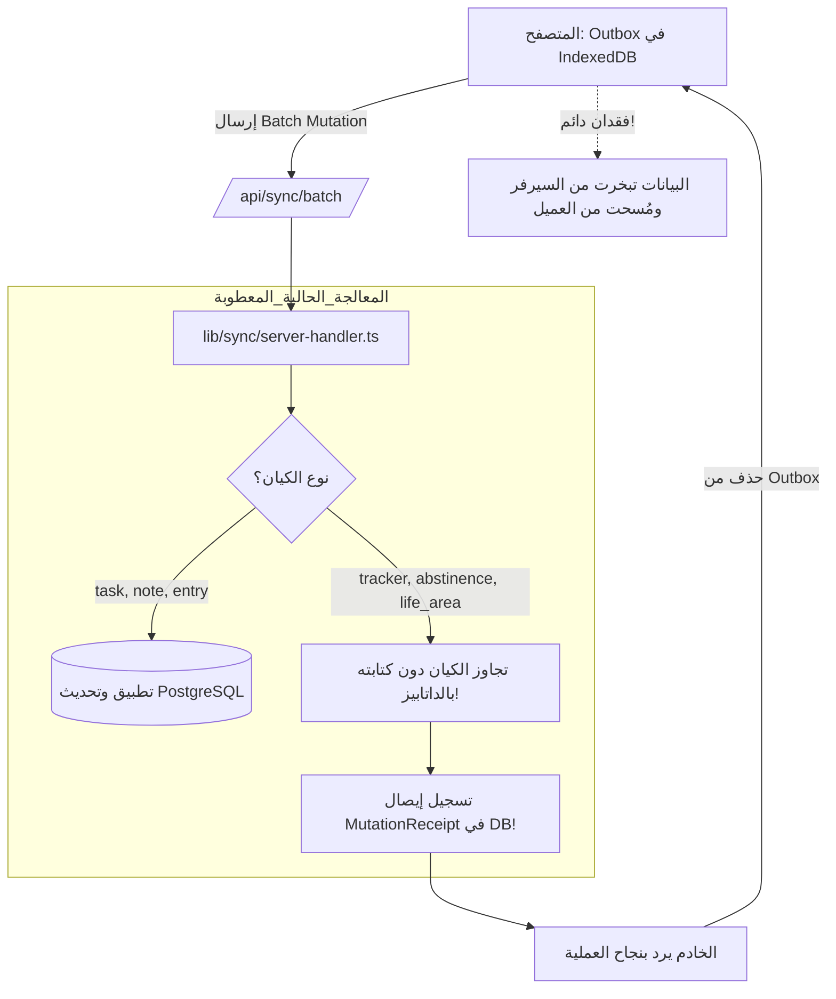
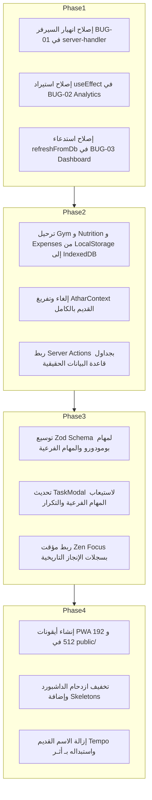

# تقرير الفحص والتدقيق الشامل لمنتج ومشروع «أثـر» (Athar Product Audit)

**تاريخ التدقيق:** 9 نوفمبر 2026  
**طبيعة التقرير:** تشخيصي استقصائي شامل مبني على فحص الكود المصدري الفعلي فقط دون افتراضات مسبقة.  
**حالة الكود:** لم يتم إجراء أي تعديل أو إصلاح أو حذف لأي ملف في المشروع التزاماً بالقواعد الصارمة.

---

## 1. الملخص التنفيذي والحالة الحالية للمشروع (Executive Summary)

يمر مشروع «أثـر» بحالة **انشطار معماري حاد (Architectural Split)** يقسم النظام إلى كودين منفصلين يعملان بالتوازي داخل نفس تطبيق Next.js 16:

1. **المسار الحديث (Modern Local-First / PostgreSQL / Prisma 7 / Better Auth / IDB):**
   - مطبق جزئياً في مسارات: المهام (`/tasks`)، المخطط الأسبوعي (`/planner`)، والمكتبة المركزية `lib/local-db` ومحرك المزامنة `lib/sync`.
   - يتمتع ببنية قوية مصممة للعمل دون اتصال (Offline-First) بواسطة IndexedDB (`athar_local_v2`).
   - **لكنه يعاني من ثغرات قاتلة في محرك المزامنة تسبب فقداناً صامتاً للبيانات (Silent Data Loss)** وأخطاء انهيار لحظية (Runtime Crashes) في بعض الواجهات.

2. **المسار القديم المتروك (Legacy Prototype / LocalStorage / Mock Data / AtharContext):**
   - مطبق في صفحات: الجيم والتمارين (`/gym`)، التغذية (`/nutrition`)، والمصاريف المالية (`/expenses`).
   - يعتمد كلياً على `AtharContext.jsx` ومصفوفات تجريبية ثابتة (`mockData.js`) وتخزين متصفح بدائي `localStorage` (`athar_expenses`, `athar_nutrition`, `athar_gym`).
   - تطلق هذه الصفحات استدعاءات خادم (Server Actions) في الفراغ عبر `.catch(() => {})` دون أن تقرأ أبداً أي بيانات حقيقية من قاعدة بيانات PostgreSQL أو تعرضها للمستخدم.

---

## 2. تصنيف الميزات (Feature Matrix)

### 2.1 الميزات الموجودة وتعمل فعلياً (Fully Functional)
- **نظام المصادقة الأساسي (Authentication):** التسجيل وتسجيل الدخول عبر البريد الإلكتروني وكلمة المرور وجلسات الكوكيز المشفرة المدعومة بـ Better Auth.
- **إدارة المهام الأساسية (Core Tasks):** إنشاء مهمة، تعديلها، تبديل حالتها (TODO/COMPLETED)، تحديد الأولوية، وربطها بتاريخ محدد وتخزينها محلياً في IndexedDB مع جدولتها للمزامنة.
- **المخطط الأسبوعي (Weekly Planner Engine):** توليد شبكة الأيام السبعة للأسبوع، وحساب المقاييس الزمنية (ساعات العمل المخططة والمنجزة، واليوم الأكثر إنتاجية Peak Day).
- **نظام التراجع والصوتيات (Audio Feedback):** تشغيل مؤثرات صوتية تزامنية مع إنجاز المهام وإيقافها وحفظ تفضيل المستخدم في التخزين المحلي.
- **المؤقت البصري للتركيز العميق (Zen Focus Modal):** شاشة كاملة لعرض عد تنازلي دائري بأسلوب بومودورو مع دعم اختصارات لوحة المفاتيح (`P` للإيقاف، `D` للإنجاز، `Esc` للخروج).

### 2.2 الميزات الموجودة جزئياً ومحدودة أو معطوبة (Partially Functional / Degraded)
- **محرك المزامنة (Sync Engine & Outbox):**
  - يعمل فقط للمهام (`task`)، واليوميات (`daily_note`)، وتدوينات العادات (`tracker_entry`)، وجداول الجيم والتغذية والمصاريف.
  - **معطوب بالكامل لتعريفات المتتبعات (`tracker`)، وجلسات التعافي (`abstinence`)، ومجالات الحياة (`life_area`)؛ حيث يستقبلها الخادم ويسجل إيصال نجاح وهمي دون حفظها في قاعدة البيانات، مما يخدع المتصفح بحذفها من طابور المزامنة نهائياً!
- **تتبع الصلوات (Prayer Tracking):**
  - ليس ميزة مخصصة (First-class Feature) بل استعلام كشفي (Heuristic Query) يبحث عن أي متتبع يحتوي اسمه على "صلاة" أو "prayer".
  - لا يحتوي على أي حساب جغرافي لمواقيت الصلاة، ولا إشعارات أذان، ولا يدعم وضع الضيف.
- **سجل التاريخ والتقويم والتحليلات (`/calendar` & `/analytics`):**
  - يعرض التقويم بيانات المستخدم المسجل، لكنه معطوب للزائر الضيف بسبب غياب حقل `hasData`.
  - صفحة التحليلات (`/analytics`) تنهار برمجياً فور فتحها بسبب استدعاء `useEffect` غير المستورد.
- **مذكرات اليومية (`/journal`):**
  - تتيح حفظ الملاحظات للمستخدم المسجل، لكن في وضع الضيف تتوقف الملاحة بين التواريخ كلياً بسبب شرط إرجاع مبكر خاطئ.
- **تطبيق الويب التقدمي (PWA & Service Worker):**
  - مسجل ويعمل مع استراتيجية Network-First ويقدم صفحة `offline.html`، لكنه يفشل في التثبيت الرسمي في متصفحات الجوال بسبب فقدان ملفات الأيقونات (`/icon-192.png` و `/icon-512.png`).

### 2.3 الميزات غير الموجودة أو وهمية بالواجهة فقط (Missing / Phantom Features)
- **المهام الفرعية والتكرار التلقائي وبومودورو (Subtasks, Recurring Tasks, Pomodoro Config):**
  - رغم وجود حقولها في Schema قاعدة البيانات وIndexedDB، إلا أنها **محذوفة تماماً من واجهة إضافة المهام (`TaskModal.tsx`) ومستبعدة من التحقق (`lib/validations/task.ts`)**، وبالتالي لا يمكن للمستخدم إنشاء مهام فرعية أو تكرارها أو تحديد دورات البومودورو.
- **مزامنة بيانات الجيم والتغذية والمصاريف مع الواجهة:**
  - واجهات `/gym` و `/nutrition` و `/expenses` تقرأ وتكتب فقط في `localStorage` البدائي لنموذج Prototype وتطبع رسوم بيانات وهمية (Mock Data)، ولا تقرأ مطلقاً من جداول PostgreSQL (`GymWorkout`, `MealEntry`, `ExpenseEntry`).
- **حفظ جلسات التركيز (Focus Duration Persistence):**
  - الوقت المستغرق داخل مؤقت Zen Focus لا يُسجل في سجلات التتبع الزمني أو اليومية، ويضيع فور إغلاق النافذة.

---

## 3. سجل العيوب والمشاكل المكتشفة بالتفصيل (Detailed Findings)

| المعرف | الموقع الدقيق (الملف + السطر/الدالة) | سبب المشكلة الجذري | الأثر على المستخدم | الخطورة (Severity) | الحل الهندسي المقترح |
| :--- | :--- | :--- | :--- | :--- | :--- |
| **BUG-01** | `lib/sync/server-handler.ts`<br>السطور 130–385 في الدالة `processSyncBatch` | حلقة معالجة العمليات (`mutations`) لا تحتوي على تفريعات `else if` للكيانات: `tracker`، `abstinence`، و`life_area`، ورغم ذلك يُنفذ سطر تسجيل الإيصال `tx.mutationReceipt.create`! | **فقدان صامت ودائم للبيانات:** عند إنشاء عادة أو تعافي دون اتصال، يتجاهل السيرفر حفظها، ثم يرسل استجابة "Duplicate" في المحاولة التالية، فيحذفها العميل ظناً أنها حُفظت! | **CRITICAL** | إضافة الفروع المفقودة داخل `processSyncBatch` لتنفيذ `tx.tracker.upsert` و`tx.abstinenceTracker.upsert` و`tx.lifeArea.upsert` قبل تسجيل الإيصال. |
| **BUG-02** | `components/analytics/AnalyticsClient.jsx`<br>السطر 3 والسطر 72 | استدعاء `useEffect(() => { ... }, [user])` في السطر 72 دون استيراده في السطر 3 (`import { useState } from "react"`). | **انهيار الصفحة كلياً (Runtime Crash):** يظهر خطأ `ReferenceError: useEffect is not defined` بشاشة بيضاء فور زيارة صفحة `/analytics`. | **CRITICAL** | تصحيح الاستيراد ليصبح: `import { useState, useEffect } from "react";`. |
| **BUG-03** | `components/dashboard/DashboardClient.jsx`<br>السطر 108 في `refreshDashboardData` | استدعاء الدالة `localTasksHelper.refreshFromDb().catch(...)` مع أن الدالة غير معرّفة وغير موجودة في الكائن العائد من `useLocalTasks.ts`. | **خطأ استثناء فوري:** رمي استثناء `TypeError: localTasksHelper.refreshFromDb is not a function` مما يقطع تحديث لوحة التحكم ويملأ الـ Console بالأخطاء. | **HIGH** | استبدال هذا الاستدعاء بآلية تحديث حقيقية مصدرة من `useLocalTasks` (مثل `refreshTasks` أو إعادة القراءة من `localTaskRepo`). |
| **BUG-04** | `components/journal/JournalClient.jsx`<br>السطر 66 في الدالة `loadDayData` | وجود فحص `if (!user) return;` في أول الدالة، بينما وُضعت معالجة قراءة مذكرات الضيف من IndexedDB في فرع متأخر داخل نفس الدالة! | **تعطل مذكرات الضيف:** عجز المستخدم الزائر (Guest) عن تصفح أو استرجاع مذكرات أي يوم سابق عند النقر على التقويم. | **HIGH** | نقل منطق قراءة IndexedDB للضيف ليعمل قبل فحص `if (!user)` في `loadDayData`. |
| **BUG-05** | `app/gym/page.js`، `app/nutrition/page.js`، `app/expenses/page.js`<br>عبر `AtharContext.jsx` السطر 675 | عزل هذه الصفحات داخل `AtharContext` القديم، وتثبيت تاريخ المعاملات في السطر 675 على تاريخ جامد `"2026-11-05"`. | **انفصال البيانات:** البيانات المسجلة بالجيم والمصاريف لا تذهب لقاعدة البيانات الحقيقية وتظل محبوسة في LocalStorage لتاريخ ثابت قديم. | **HIGH** | ربط هذه الصفحات بمستودعات IndexedDB الحديثة ومزامنتها عبر Server Actions لقاعدة البيانات بدلاً من التخزين القديم. |
| **BUG-06** | `lib/validations/task.ts`<br>`CreateTaskSchema` & `UpdateTaskSchema` و `components/tasks/TaskModal.tsx` | إسقاط الحقول `subtasks`, `isPomodoro`, `workCycle`, `breakCycle`, `isRecurring` من التحقق ومن مدخلات الواجهة. | **ميزات ميتة:** حرمان المستخدم من جدولة مهام بومودورو أو إضافة مهام فرعية أو متكررة رغم دعم الـ Database لها. | **HIGH** | تضمين الحقول في `CreateTaskSchema` وبناء مدخلاتها المرئية في `TaskModal.tsx`. |
| **BUG-07** | `public/manifest.json`<br>السطور 12–23 | ملف المانيفست يشير إلى أيقونات `/icon-192.png` و `/icon-512.png` غير الموجودة في مجلد `public/` (يوجد فقط `icon.svg`). | **فشل معايير PWA:** رفض متصفحات الهواتف تثبيت التطبيق كتطبيق هاتف مستقل لعدم توفر متطلبات الأيقونات القياسية. | **MEDIUM** | توليد ملفات PNG المطلوبة بالأحجام 192x192 و 512x512 ووضعها في المجلد `public/`. |
| **BUG-08** | `components/Navbar.jsx`<br>السطر 245 | وجود نص تجاري قديم جامد للعلامة التجارية `"Tempo "` بدلاً من اسم التطبيق العربي `"أثـر"`. | **تشوه الهوية البصرية:** ظهور اسم مشروع سابق للمستخدم في شريط التنقل العلوي مما يربك هوية التطبيق. | **LOW** | استبدال النص الجامد بالنص الصحيح: `أثـر`. |
| **BUG-09** | `components/calendar/CalendarClient.jsx`<br>السطور 43–60 في `loadMonthData` | تجميع مهام الضيف لا يضع حقل `hasData: true` للأيام التي تحتوي على مهام، بينما تعتمد الواجهة في السطر 211 و 225 على هذا الحقل لتلوين اليوم. | **خلل عرض التقويم:** عدم ظهور النقاط الخضراء ومؤشرات الإنجاز لأيام الضيف رغم إتمامه لمهامه في ذلك اليوم. | **MEDIUM** | تعيين `hasData: completedTasks > 0 || taskCount > 0` أثناء تجميع بيانات الأيام للضيف. |
| **BUG-010** | `components/dashboard/ActiveTimerWidget.jsx`<br>السطور 32–56 | تخزين مؤقت التركيز في ذاكرة React (`useState`) دون حفظ الحالة في `IndexedDB` أو `localStorage`. | **فقدان الوقت والجهد:** تصفير المؤقت فوراً إذا قام المستخدم بتحديث الصفحة أو الانتقال لصفحة أخرى قبل ضغط "إنهاء". | **MEDIUM** | ربط المؤقت بطابع زمني للبدء (`startedAt`) وحفظه في التخزين المحلي لاسترجاعه عند إعادة التحميل. |

---

## 4. مخاطر فقدان البيانات وتكرارها (Data Integrity & Sync Risks)



### 1. معضلة الإيصال الوهمي (The Phantom Receipt Bug)
- **الموقع:** `lib/sync/server-handler.ts` (السطور 387-395).
- **الآلية:** كما يوضح المخطط أعلاه، عند وصول طفرة لإنشاء عادة جديدة (`tracker`) تم إنشاؤها بدون اتصال بالإنترنت، يمر الكيان دون أن يلتقطه أي شرط `else if`. ولكون سطر `tx.mutationReceipt.create` يقع خارج الشروط، يقوم الخادم بحفظ إيصال المعاملة. عندما يعاود العميل المحاولة، يقرأ الخادم الإيصال ويجيب بأنه "مكرر ومطبق سابقاً"، فيقوم العميل بمسحه من الـ Outbox! النتيجة: فقدان تام لبيانات العادة أو التعافي دون أي تنبيه للمستخدم.

### 2. تضارب التعديلات المتزامنة (Lost Updates / No Concurrency Control)
- **الموقع:** `lib/sync/server-handler.ts` السطور 162–185.
- **الآلية:** يعتمد تحديث المهام على أسلوب "Last-Write-Wins" الساذج دون التحقق من أن رقم النسخة القادمة من العميل (`mut.version`) يطابق رقم النسخة الحالية في السيرفر قبل التعديل. إذا عدل المستخدم نفس المهمة من الهاتف والكمبيوتر أثناء انقطاع مؤقت، فإن النسخة المتأخرة ستسحق وتطمس تعديلات النسخة الأولى كلياً.

---

## 5. تقييم الأمان والمصادقة (Security & Authentication Audit)

1. **مخاطر السر العشوائي المؤقت (Ephemeral Secret Fallback):**
   - في `lib/auth.ts` السطر 28:
   ```ts
   secret: process.env.BETTER_AUTH_SECRET || (process.env.NODE_ENV === "production" ? undefined : crypto.randomUUID()),
   ```
   - **الخطر:** في حال نشر المشروع على منصة سيرفرلس (مثل Vercel) وتأخر ضبط متغير البيئة، فإن كل Serverless Instance سينشئ سراً عشوائياً مختلفاً، مما يؤدي لإبطال جلسات المستخدمين باستمرار وظهور أخطاء `401 Unauthorized` عشوائية.

2. **تسريب النطاقات التجريبية السابقة (Untrusted Origin Sprawl):**
   - في `lib/auth.ts` السطور 37–42، يوجد نطاق جامد موثوق: `https://tempo-lite-nu.vercel.app`.
   - **الخطر:** السماح بنطاق قديم يتبع تطبيقاً آخر يفتح ثغرة محتملة لهجمات CORS وتزوير الطلبات المتبادلة (CSRF) إذا كان ذلك النطاق مملوكاً لطرف آخر لاحقاً.

3. **غياب التحقق من صحة التواريخ في الإرجاء (`postponeTask`):**
   - في `actions/tasks.ts` السطر 190، تقبل الدالة `daysOrDate` كنص مباشر دون التحقق من تطابقه مع النمط القياسي `YYYY-MM-DD` عبر Zod، مما قد يؤدي لإدخال تواريخ غير صالحة تسقط استعلامات الواجهة اللاحقة.

---

## 6. فحص الـ PWA والدعم خارج الاتصال (Offline & PWA Audit)

1. **ملفات الخدمة والـ Service Worker:**
   - ملف `public/sw.js` يطبق استراتيجية Network-First للواجهات وCache-First للأصول الثابتة، وهو نمط سليم يدعم العمل أوفلاين.
   - لكنه لا يقوم بعمل pre-cache للمسارات الأساسية (`/tasks`, `/planner`, `/habits`) أثناء حدث `install`، مما يعني أن المستخدم إذا انقطع اتصاله قبل فتح تلك الصفحات لمرة واحدة فلن تفتح معه مطلقاً وسيرى صفحة `offline.html`.

2. **أيقونات المانيفست (Manifest 404s):**
   - ملف `manifest.json` يطلب ملفي PNG مفقودين:
     - `/icon-192.png`
     - `/icon-512.png`
   - هذا يمنع متصفح Chrome على أندرويد وSafari على iOS من إظهار زر "Install App" في شريط العنوان أو إضافة التطبيق للشاشة الرئيسية بكامل صلاحيات الـ Standalone PWA.

---

## 7. فحص الأداء وتجربة المستخدم وتصميم الواجهات (UX & UI Density)

1. **ازدحام لوحة التحكم الرئيسية (`/`):**
   - الصفحة الرئيسية تجمع في نفس الوقت: بطاقة الصلوات، مؤقت التركيز السريع، ودجات المهام اليومية، شبكة العادات التفاعلية، والخط الزمني لليوم.
   - هذا يخلق حمولة بصرية مفرطة (Visual Overload) وتكدساً على شاشات الهواتف المحمولة الصغيرة، مع بطء نسبي في الـ First Contentful Paint نتيجة تحميل 6 استعلامات ثقيلة متوازية.

2. **فقدان الهيكل الهيكلي للتحميل (Missing Loading Skeletons):**
   - في معظم الصفحات، يؤدي الانتقال بين الأيام إلى وميض عنيف (Layout Shift) واستبدال المحتوى بمؤشر دوران (`Loader2`) بسيط يزعج العين ويفسد الإحساس بالتطبيق السريع.

3. **التصميم المتجاوب (Responsive Breakpoints):**
   - جدول المخطط الأسبوعي (`WeeklyPlannerView.tsx`) يحتوي على 7 أعمدة. على الشاشات المتوسطة (Tablets)، تتقلص الأعمدة لمساحة ضيقة جداً تجعل أسماء المهام مقطوعة ولا يمكن قراءتها بسهولة دون تمرير أفقي غير مريح.

---

## 8. خريطة الاعتماديات بين الإصلاحات (Fix Dependencies Roadmap)

لكي تتم معالجة هذه المشاكل دون حدوث فوضى برمجية أو انحدار (Regression)، يجب أن تتبع أي خطة إصلاح مستقبلية هذا الترتيب الحتمي:



---

## 9. بروتوكول الاختبارات والتحقق المطلوب بعد أي إصلاح مستقبلي (Verification Plan)

| رقم الاختبار | السيناريو وخطوات التحقق | النتيجة المتوقعة للنجاح |
| :--- | :--- | :--- |
| **TEST-01** | **اختبار مزامنة العادات بدون إنترنت:** قطع الإنترنت عن المتصفح، إنشاء عادة جديدة في `/habits`، إعادة الاتصال، فحص جدول `Tracker` في قاعدة البيانات. | نزول العادة برقمها التعريفي في جدول `Tracker` داخل PostgreSQL واختفاؤها السليم من جدول الـ Outbox بالمتصفح. |
| **TEST-02** | **اختبار الدخول لصفحة التحليلات:** زيارة المسار `/analytics` كزائر ضيف وبحساب مسجل عبر التبويب الخفي. | فتح الصفحة وعرض المخطط البياني دون أي انهيار برمجى أو ظهور شاشة بيضاء أو خطأ في الـ Console. |
| **TEST-03** | **اختبار تغيير التاريخ في الداشبورد:** فتح صفحة الداشبورد والنقر على أسهم التنقل بين الأيام السابقة والقادمة. | تحديث بطاقات اليوم بسلاسة دون رمي خطأ `TypeError: refreshFromDb is not a function`. |
| **TEST-04** | **اختبار تصفح مذكرات الضيف:** في وضع الضيف، كتابة مذكرة ليوم أمس، ثم العودة لليوم الحالي، ثم الرجوع ليوم أمس مجدداً. | ظهور المذكرة المحفوظة أمس كاملة دون إفراغ الحقول أو توقف التحميل. |
| **TEST-05** | **اختبار تثبيت تطبيق PWA:** فتح التطبيق عبر متصفح Chrome أو Safari في وضع التدقيق Lighthouse أو جوال فعلي. | اجتياز فحص PWA بنسبة 100% وظهور مطالبة التثبيت وتوفر الأيقونات دون أخطاء 404. |
| **TEST-06** | **اختبار تسجيل الجيم والمصاريف:** إضافة وجبة أو تمرين أو مصروف وفحص IndexedDB وقاعدة بيانات PostgreSQL. | ظهور التدوينة فوراً في واجهة المستخدم وحفظها في قاعدة البيانات المركزية دون الاعتماد على `localStorage`. |

---
**نهاية تقرير الفحص والتشخيص الفني.**  
*جاهز لمناقشة النتائج واستعراض أولويات المرحلة القادمة فور موافقة المستخدم.*

