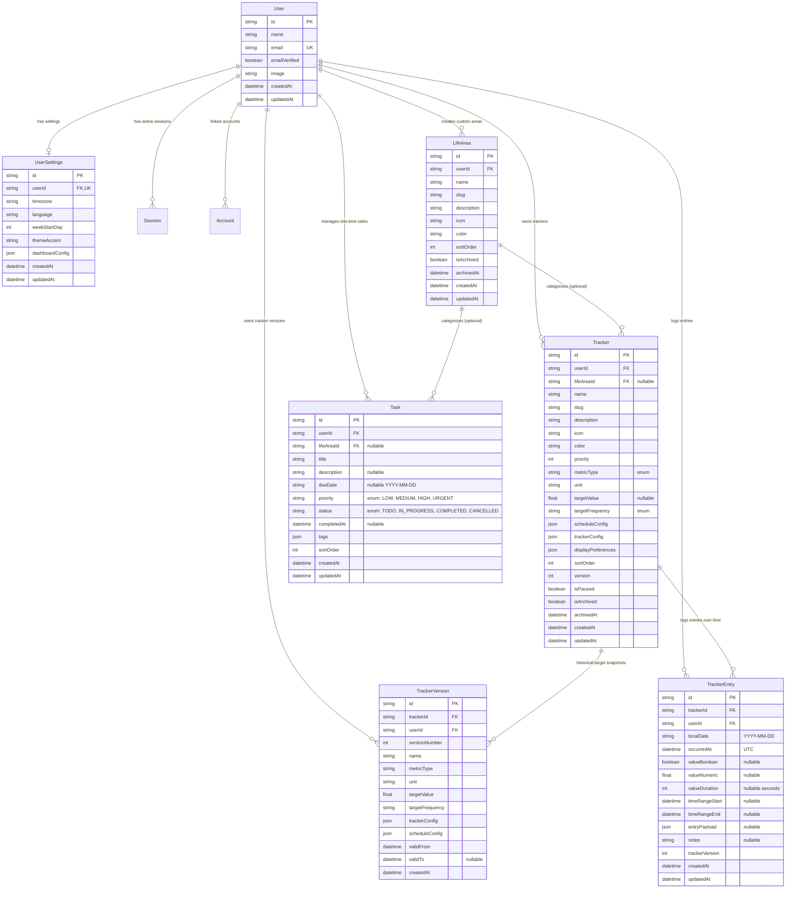

# Athar (أثـر) — Database Design & Schema Specification

> **Status**: APPROVED DATABASE DESIGN  
> **Phase**: PHASE 1 DELIVERABLE  
> **ORM & Dialect**: Prisma 7.x · PostgreSQL (Supabase)  
> **Auth Engine**: Better Auth 1.x (Google OAuth)  

---

## 1. Visual Entity-Relationship Diagram (ERD)



---

## 2. Complete Prisma Schema Model Proposal

```prisma
datasource db {
  provider  = "postgresql"
  url       = env("DATABASE_URL")
  directUrl = env("DIRECT_URL")
}

generator client {
  provider = "prisma-client-js"
}

// -----------------------------------------------------------------------------
// 1. BETTER AUTH REQUIRED MODELS
// -----------------------------------------------------------------------------

model User {
  id            String    @id @default(cuid())
  name          String
  email         String    @unique
  emailVerified Boolean   @default(false)
  image         String?
  createdAt     DateTime  @default(now())
  updatedAt     DateTime  @updatedAt

  // Better Auth relations
  sessions      Session[]
  accounts      Account[]

  // Domain relations
  settings        UserSettings?
  lifeAreas       LifeArea[]
  trackers        Tracker[]
  trackerVersions TrackerVersion[]
  trackerEntries  TrackerEntry[]
  tasks           Task[]

  @@map("user")
}

model Session {
  id        String   @id @default(cuid())
  expiresAt DateTime
  token     String   @unique
  ipAddress String?
  userAgent String?
  userId    String
  user      User     @relation(fields: [userId], references: [id], onDelete: Cascade)
  createdAt DateTime @default(now())
  updatedAt DateTime @updatedAt

  @@index([userId])
  @@map("session")
}

model Account {
  id                    String    @id @default(cuid())
  accountId             String
  providerId            String
  userId                String
  user                  User      @relation(fields: [userId], references: [id], onDelete: Cascade)
  accessToken           String?   @db.Text
  refreshToken          String?   @db.Text
  idToken               String?   @db.Text
  accessTokenExpiresAt  DateTime?
  refreshTokenExpiresAt DateTime?
  scope                 String?
  password              String?   @db.Text
  createdAt             DateTime  @default(now())
  updatedAt             DateTime  @updatedAt

  @@unique([providerId, accountId])
  @@index([userId])
  @@map("account")
}

model Verification {
  id         String    @id @default(cuid())
  identifier String
  value      String
  expiresAt  DateTime
  createdAt  DateTime  @default(now())
  updatedAt  DateTime  @updatedAt

  @@unique([identifier, value])
  @@map("verification")
}

// -----------------------------------------------------------------------------
// 2. USER SETTINGS
// -----------------------------------------------------------------------------

model UserSettings {
  id              String   @id @default(cuid())
  userId          String   @unique
  user            User     @relation(fields: [userId], references: [id], onDelete: Cascade)
  
  timezone        String   @default("Asia/Riyadh") // IANA Timezone identifier
  language        String   @default("ar")          // Primary language (Arabic default)
  weekStartDay    Int      @default(6)             // 6 = Saturday (السبت), 0 = Sunday
  themeAccent     String   @default("violet")      // Brand accent token
  dashboardConfig Json     @default("{}")          // Widget layout and visibility
  
  createdAt       DateTime @default(now())
  updatedAt       DateTime @updatedAt

  @@map("user_settings")
}

// -----------------------------------------------------------------------------
// 3. USER-DEFINED LIFE AREAS (CATEGORIES)
// -----------------------------------------------------------------------------

model LifeArea {
  id          String    @id @default(cuid())
  userId      String
  user        User      @relation(fields: [userId], references: [id], onDelete: Cascade)
  
  name        String
  slug        String
  description String?
  icon        String    @default("Sparkles") // Lucide icon name
  color       String    @default("violet")   // Tailwind color token
  sortOrder   Int       @default(0)
  
  isArchived  Boolean   @default(false)
  archivedAt  DateTime?
  
  createdAt   DateTime  @default(now())
  updatedAt   DateTime  @updatedAt

  // Domain relations
  trackers    Tracker[]
  tasks       Task[]

  @@unique([userId, slug])
  @@index([userId, isArchived, sortOrder])
  @@map("life_area")
}

// -----------------------------------------------------------------------------
// 4. DYNAMIC TRACKERS & METRIC TYPES
// -----------------------------------------------------------------------------

enum TrackerMetricType {
  BOOLEAN     // Binary daily completion
  COUNTER     // Incremental count with steps and target
  NUMBER      // Quantitative measurement (weight, pages)
  DURATION    // Elapsed time in seconds/minutes
  TIME_RANGE  // Start and end timestamps (e.g. sleep)
  CHECKLIST   // Multi-item checklist (e.g. 5 prayers)
  AVOIDANCE   // Relapse and urge tracking (e.g. smoking)
}

enum TargetFrequency {
  DAILY
  WEEKLY
  CUSTOM
}

model Tracker {
  id                 String            @id @default(cuid())
  userId             String
  user               User              @relation(fields: [userId], references: [id], onDelete: Cascade)
  
  lifeAreaId         String?
  lifeArea           LifeArea?         @relation(fields: [lifeAreaId], references: [id], onDelete: SetNull)
  
  name               String
  slug               String
  description        String?
  icon               String            @default("Flame") // Lucide icon identifier
  color              String            @default("emerald") // Tailwind token (e.g. cyan, orange)
  priority           Int               @default(1)       // Priority ranking
  
  metricType         TrackerMetricType
  unit               String?                             // e.g. "كوب", "دقيقة", "صفحة", "كجم"
  
  targetValue        Float?                              // Target goal per day/week
  targetFrequency    TargetFrequency   @default(DAILY)
  
  scheduleConfig     Json              @default("{}")    // Active days, schedules
  trackerConfig      Json              @default("{}")    // Type-specific schema parameters
  displayPreferences Json              @default("{}")    // Card styling, visibility
  
  sortOrder          Int               @default(0)
  version            Int               @default(1)       // Increments on config/target update
  
  isPaused           Boolean           @default(false)
  isArchived         Boolean           @default(false)
  archivedAt         DateTime?
  
  createdAt          DateTime          @default(now())
  updatedAt          DateTime          @updatedAt

  // Historical and log relations
  versions           TrackerVersion[]
  entries            TrackerEntry[]

  @@unique([userId, slug])
  @@index([userId, isArchived, isPaused, sortOrder])
  @@index([userId, lifeAreaId])
  @@map("tracker")
}

// -----------------------------------------------------------------------------
// 5. HISTORICAL INTEGRITY & TARGET SNAPSHOTS
// -----------------------------------------------------------------------------

model TrackerVersion {
  id              String            @id @default(cuid())
  trackerId       String
  tracker         Tracker           @relation(fields: [trackerId], references: [id], onDelete: Cascade)
  userId          String
  user            User              @relation(fields: [userId], references: [id], onDelete: Cascade)
  
  versionNumber   Int
  name            String
  metricType      TrackerMetricType
  unit            String?
  targetValue     Float?
  targetFrequency TargetFrequency
  trackerConfig   Json
  scheduleConfig  Json
  
  validFrom       DateTime          @default(now())
  validTo         DateTime?         // Nullable: active until superseded
  
  createdAt       DateTime          @default(now())

  @@unique([trackerId, versionNumber])
  @@index([userId, trackerId, validFrom])
  @@map("tracker_version")
}

// -----------------------------------------------------------------------------
// 6. TRACKER ENTRIES (POLYMORPHIC LOGS)
// -----------------------------------------------------------------------------

model TrackerEntry {
  id              String    @id @default(cuid())
  trackerId       String
  tracker         Tracker   @relation(fields: [trackerId], references: [id], onDelete: Cascade)
  userId          String
  user            User      @relation(fields: [userId], references: [id], onDelete: Cascade)
  
  // Temporal dual-axis coordinates
  localDate       String    // Formatted "YYYY-MM-DD" representing user's calendar bucket
  occurredAt      DateTime  @default(now()) // Exact UTC timestamp of the physical event
  
  // Polymorphic values (populated based on tracker.metricType)
  valueBoolean    Boolean?
  valueNumeric    Float?
  valueDuration   Int?      // Duration in total elapsed seconds
  timeRangeStart  DateTime? // Range start (UTC)
  timeRangeEnd    DateTime? // Range end (UTC)
  entryPayload    Json?     // Detailed metadata (checklist state, sets, relapse mood)
  
  notes           String?   @db.Text
  trackerVersion  Int       @default(1) // Snapshot version active at entry creation
  
  createdAt       DateTime  @default(now())
  updatedAt       DateTime  @updatedAt

  // High-performance query indexes
  @@index([userId, localDate])
  @@index([trackerId, localDate])
  @@index([userId, trackerId, occurredAt])
  @@map("tracker_entry")
}

// -----------------------------------------------------------------------------
// 7. DECOUPLED TASKS (ONE-TIME ACTIONS)
// -----------------------------------------------------------------------------

enum TaskPriority {
  LOW
  MEDIUM
  HIGH
  URGENT
}

enum TaskStatus {
  TODO
  IN_PROGRESS
  COMPLETED
  CANCELLED
}

model Task {
  id          String       @id @default(cuid())
  userId      String
  user        User         @relation(fields: [userId], references: [id], onDelete: Cascade)
  
  lifeAreaId  String?
  lifeArea    LifeArea?    @relation(fields: [lifeAreaId], references: [id], onDelete: SetNull)
  
  title       String
  description String?      @db.Text
  dueDate     String?      // Local calendar due date "YYYY-MM-DD"
  
  priority    TaskPriority @default(MEDIUM)
  status      TaskStatus   @default(TODO)
  completedAt DateTime?
  
  tags        Json         @default("[]") // String array of labels
  sortOrder   Int          @default(0)
  
  createdAt   DateTime     @default(now())
  updatedAt   DateTime     @updatedAt

  @@index([userId, status, dueDate])
  @@index([userId, lifeAreaId])
  @@map("task")
}
```

---

## 3. Relationships & Foreign Key Actions

| Parent Model | Child Model | Relation Field | `onDelete` Action | Justification |
|---|---|---|---|---|
| `User` | `UserSettings` | `userId` | `Cascade` | Deleting user removes user settings. |
| `User` | `LifeArea` | `userId` | `Cascade` | Deleting user cleans user's categories. |
| `User` | `Tracker` | `userId` | `Cascade` | Complete user data isolation and cleanup. |
| `User` | `TrackerEntry`| `userId` | `Cascade` | Enforces tenant-level cleanup. |
| `User` | `Task` | `userId` | `Cascade` | Deleting user cleans tasks. |
| `LifeArea` | `Tracker` | `lifeAreaId` | `SetNull` | Archiving/deleting an area preserves all trackers and entries! |
| `LifeArea` | `Task` | `lifeAreaId` | `SetNull` | Deleting an area preserves the task. |
| `Tracker` | `TrackerVersion` | `trackerId` | `Cascade` | Versions belong to the tracker. |
| `Tracker` | `TrackerEntry`| `trackerId` | `Cascade` | Entries belong to the tracker. |

---

## 4. Unique Constraints & Indexing Strategy

### Critical Unique Constraints
1. `User.email`: `@@unique([email])` (enforces single account per email).
2. `LifeArea`: `@@unique([userId, slug])` (category slugs unique per tenant).
3. `Tracker`: `@@unique([userId, slug])` (tracker slugs unique per tenant).
4. `TrackerVersion`: `@@unique([trackerId, versionNumber])` (strict sequential versioning per tracker).
5. `Account`: `@@unique([providerId, accountId])` (Better Auth OAuth identity mapping).

### Query Indexing Strategy
- **Daily Dashboard Queries**:
  - `TrackerEntry`: `@@index([userId, localDate])` allows retrieving all logs across all habits for any given day in a single index scan (`O(log N)`).
- **Tracker Detail Page & Streak Calculations**:
  - `TrackerEntry`: `@@index([trackerId, localDate])` enables sequential chronological history scans across calendar dates.
- **Task Board & Backlog**:
  - `Task`: `@@index([userId, status, dueDate])` allows instant filtering of active tasks vs completed backlog without scanning whole tables.
- **Active Trackers Grid**:
  - `Tracker`: `@@index([userId, isArchived, isPaused, sortOrder])` guarantees high-speed rendering of active habits on the main dashboard.

---

## 5. Concrete Tracker Type Configurations & Entry Value Examples

Every `metricType` has a distinct JSON configuration contract validated via Zod:

### 1. `BOOLEAN` (Simple Daily Completion)
- **Tracker Example**: Morning Adhkar (أذكار الصباح)
- **`trackerConfig`**:
```json
{
  "allowMultiplePerDay": false,
  "celebrationMessage": "تقبل الله طاعتك وأدام ذكرك ✨"
}
```
- **`TrackerEntry` Row**:
  - `valueBoolean`: `true`
  - `entryPayload`: `null`

---

### 2. `COUNTER` (Incremental Tallies)
- **Tracker Example**: Water Hydration (شرب الماء)
- **`trackerConfig`**:
```json
{
  "step": 1,
  "quickIncrements": [1, 2, 4],
  "min": 0,
  "max": 30,
  "defaultIncrement": 1
}
```
- **`targetValue`**: `14.0` (14 cups)
- **`unit`**: `"كوب (250 مل)"`
- **`TrackerEntry` Row** (Logged multiple times during the day):
  - Entry 1: `valueNumeric: 2.0`, `notes: "كوبين بعد الاستيقاظ"`
  - Entry 2: `valueNumeric: 1.0`, `notes: "مع وجبة الغداء"`

---

### 3. `NUMBER` (Physical Measurements)
- **Tracker Example**: Body Weight (الوزن والكتلة)
- **`trackerConfig`**:
```json
{
  "precision": 1,
  "min": 40.0,
  "max": 250.0,
  "trackDelta": true,
  "targetTrend": "LOSS"
}
```
- **`targetValue`**: `78.5`
- **`unit`**: `"كجم"`
- **`TrackerEntry` Row**:
  - `valueNumeric`: `81.2`
  - `entryPayload`: `{"fatPercentage": 16.4, "muscleMass": 38.2}`

---

### 4. `DURATION` (Focused Deep Work / Study)
- **Tracker Example**: Programming Sessions (البرمجة والعمل العميق)
- **`trackerConfig`**:
```json
{
  "timerMode": "STOPWATCH",
  "minSessionSeconds": 60,
  "targetDailySeconds": 12600,
  "allowManualLogging": true,
  "requireSessionNotes": false
}
```
- **`targetValue`**: `210.0` (210 minutes)
- **`unit`**: `"دقيقة"`
- **`TrackerEntry` Row**:
  - `valueDuration`: `5400` (90 minutes in seconds)
  - `entryPayload`: {
      "sessionType": "deep_work",
      "project": "Athar Platform",
      "task": "Database Schema Design"
    }

---

### 5. `TIME_RANGE` (Start & End Times)
- **Tracker Example**: Sleep & Rest Tracking (تتبع النوم والاستيقاظ)
- **`trackerConfig`**:
```json
{
  "targetDailyDurationSeconds": 28800,
  "idealBedtime": "23:00",
  "idealWakeTime": "07:00",
  "trackQualityRating": true
}
```
- **`TrackerEntry` Row**:
  - `timeRangeStart`: `"2026-11-05T21:15:00.000Z"` (23:15 Local)
  - `timeRangeEnd`: `"2026-11-06T05:00:00.000Z"` (07:00 Local)
  - `valueDuration`: `27900` (7 hours 45 mins)
  - `entryPayload`: {"qualityScore": 4, "deepSleepEstimateHours": 2.2}

---

### 6. `CHECKLIST` (Multi-Sub-Item Checklists)
- **Tracker Example**: The 5 Daily Prayers (الصلوات الخمس)
- **`trackerConfig`**:
```json
{
  "items": [
    { "key": "fajr", "name": "الفجر", "scheduledTime": "04:52", "hasSunnah": true, "hasJamaah": true },
    { "key": "dhuhr", "name": "الظهر", "scheduledTime": "11:48", "hasSunnah": true, "hasJamaah": true },
    { "key": "asr", "name": "العصر", "scheduledTime": "14:52", "hasSunnah": true, "hasJamaah": true },
    { "key": "maghrib", "name": "المغرب", "scheduledTime": "17:10", "hasSunnah": true, "hasJamaah": true },
    { "key": "isha", "name": "العشاء", "scheduledTime": "18:28", "hasSunnah": true, "hasJamaah": true }
  ],
  "completionThreshold": 5
}
```
- **`targetValue`**: `5.0`
- **`TrackerEntry` Row**:
  - `valueNumeric`: `5.0` (all 5 completed)
  - `entryPayload`: {
      "fajr": { "done": true, "inJamaah": true, "sunnah": true, "time": "05:05" },
      "dhuhr": { "done": true, "inJamaah": true, "sunnah": true, "time": "12:00" },
      "asr": { "done": true, "inJamaah": false, "sunnah": false, "time": "15:30", "delayReason": "اجتماع عمل" },
      "maghrib": { "done": true, "inJamaah": true, "sunnah": true, "time": "17:15" },
      "isha": { "done": true, "inJamaah": true, "sunnah": true, "time": "18:45" }
    }

---

### 7. `AVOIDANCE` (Abstinence & Relapse Tracking)
- **Tracker Example**: Smoking Cessation / Screen Time Limit (التعافي من التدخين)
- **`trackerConfig`**:
```json
{
  "avoidanceType": "ZERO_TOLERANCE",
  "dailyToleranceCount": 0,
  "trackTriggers": true,
  "trackUrgeWithoutRelapse": true,
  "urgeTriggersList": ["توتر وضغط عمل", "مع القهوة", "بعد الوجبة", "فراغ وملل"]
}
```
- **`TrackerEntry` Row (Relapse or Urge Log)**:
  - `valueNumeric`: `1.0` (relapse count)
  - `entryPayload`: {
      "isUrgeOnly": false,
      "trigger": "توتر وضغط عمل",
      "intensity": 4,
      "resistedSeconds": 180,
      "notes": "شعرت بضغط قبل موعد التسليم"
    }

---

## 6. Runtime Zod Schemas for Validation

```typescript
import { z } from "zod";

export const TrackerMetricTypeEnum = z.enum([
  "BOOLEAN",
  "COUNTER",
  "NUMBER",
  "DURATION",
  "TIME_RANGE",
  "CHECKLIST",
  "AVOIDANCE",
]);

// Generic Tracker Creation Schema
export const CreateTrackerSchema = z.object({
  name: z.string().min(1).max(100),
  description: z.string().max(500).optional(),
  icon: z.string().min(1).max(50).default("Flame"),
  color: z.string().min(1).max(30).default("emerald"),
  lifeAreaId: z.string().cuid().optional(),
  priority: z.number().int().min(1).max(10).default(1),
  metricType: TrackerMetricTypeEnum,
  unit: z.string().max(30).optional(),
  targetValue: z.number().positive().optional(),
  targetFrequency: z.enum(["DAILY", "WEEKLY", "CUSTOM"]).default("DAILY"),
  scheduleConfig: z.record(z.unknown()).default({}),
  trackerConfig: z.record(z.unknown()).default({}),
  displayPreferences: z.record(z.unknown()).default({}),
});

// Generic Tracker Entry Logging Schema
export const CreateTrackerEntrySchema = z.object({
  trackerId: z.string().cuid(),
  localDate: z.string().regex(/^\d{4}-\d{2}-\d{2}$/, "Invalid date format (YYYY-MM-DD)"),
  occurredAt: z.string().datetime().optional(), // ISO-8601 UTC
  valueBoolean: z.boolean().optional(),
  valueNumeric: z.number().optional(),
  valueDuration: z.number().int().nonnegative().optional(),
  timeRangeStart: z.string().datetime().optional(),
  timeRangeEnd: z.string().datetime().optional(),
  entryPayload: z.record(z.unknown()).optional(),
  notes: z.string().max(1000).optional(),
});
```

---

## 7. Historical Versioning Workflow

```
User edits Tracker: Changes daily reading target from 30 mins to 60 mins
                             │
                             ▼
Server Action acquires current Tracker record (version = 1)
                             │
                             ▼
Transaction Begins:
  1. INSERT INTO "tracker_version" (
       trackerId, versionNumber = 1, targetValue = 30, ...
       validFrom = tracker.createdAt, validTo = NOW()
     )
  2. UPDATE "tracker" SET
       targetValue = 60, version = 2, updatedAt = NOW()
Transaction Committed.
                             │
                             ▼
Past historical queries for January-March resolve against TrackerVersion 1.
New queries from today forward resolve against TrackerVersion 2.
Streaks and historical integrity remain 100% mathematically correct!
```

---

## 8. Date and Timezone Strategy

1. **User Timezone Persistence**:
   - `UserSettings.timezone` defaults to `Asia/Riyadh` for Arabic users or is automatically inferred upon registration via `Intl.DateTimeFormat().resolvedOptions().timeZone`.
2. **Server-Side Date Normalization**:
   - When a client logs an event, the server derives `localDate` by formatting `occurredAt` using `Intl.DateTimeFormat("en-CA", { timeZone: userTimezone })` -> `YYYY-MM-DD`.
   - If the user explicitly selects a past date on the calendar, `localDate` is set to that calendar day, preventing events from spilling across midnight due to UTC offsets.
3. **UTC Timestamps**:
   - All `DateTime` fields (`occurredAt`, `createdAt`, `completedAt`) are stored as `TIMESTAMPTZ` in PostgreSQL (UTC).

---

## 9. Security & Multi-Tenant Isolation

1. **Session Enforcement**:
   - Every database operation is performed inside a server-side context where `session.user.id` is derived from Better Auth.
   - Client-provided `userId` is rejected.
2. **Compound Filter Invariant**:
   - Every single Prisma query includes `{ where: { userId: session.user.id } }`.
3. **Foreign Key Integrity**:
   - An entry cannot be created for a `trackerId` that does not belong to the authenticated user:
   ```typescript
   // Guarded Server Action Example
   const tracker = await prisma.tracker.findFirstOrThrow({
     where: { id: input.trackerId, userId: session.user.id },
   });
   ```
4. **No Destructive Cascades to Logs**:
   - Life Areas have `onDelete: SetNull` for Trackers, ensuring a user deleting an area never wipes out their trackers or years of logged entries.

